# GUÍA TÉCNICA DE REPLICACIÓN Y ARQUITECTURA: AUTOMATIZACIÓN DE INTERBANKING

> **Objetivo de este documento:** Proveer una especificación técnica completa y agnóstica del servidor para que cualquier desarrollador o Inteligencia Artificial pueda **comprender, replicar e implementar desde cero** el motor de automatización y descarga de comprobantes de Interbanking en cualquier infraestructura (VPS, servidor dedicado, contenedor Docker o máquina local).

---

## 1. RESUMEN DEL SISTEMA Y PROBLEMA QUE RESUELVE

El módulo permite la descarga automatizada y masiva de comprobantes de transferencias bancarias (CBU / pagos a proveedores) emitidos por plataformas corporativas de **Interbanking**.

### El Desafío Técnico
Interbanking no ofrece una API REST pública documentada para la descarga directa de comprobantes en PDF. Su plataforma transaccional (**SIB1**) opera mediante:
- **Arquitectura de Framesets / IFrames anidados** de Java EE (JSP).
- Flujo de autenticación multifactor y SSO (**Central Authentication Service - CAS**).
- Restricciones rígidas de negocio en el backend bancario: **el rango de búsqueda no puede exceder 30 días corridos**.
- Botones de acción dinámicos basados en elementos `` con nombres generados por servidor.

### La Solución Implementada
Un microservicio desacoplado con un navegador headless invisible controlado por **Puppeteer** junto al plugin **Stealth** que:
1. **Inyecta cookies de sesión activas** para saltear el 100% del login y la selección de empresa, accediendo a SIB1 en segundos.
2. Posee un **mecanismo de fallback a login tradicional** por formulario (CUIL, Usuario, Password) con navegación SSO si las cookies expiran.
3. **Resuelve el límite de los 30 días** ejecutando búsquedas inteligentes y reintentos automáticos en meses de 31 días.
4. **Intercepta las descargas directas del navegador mediante Chrome DevTools Protocol (CDP)**, guardando y renombrando los archivos semánticamente para su entrega al cliente.

---

## 2. REQUISITOS DEL SISTEMA PARA REPLICACIÓN

Para desplegar este servicio en un nuevo servidor (Ubuntu, Debian o similar), se requieren las siguientes dependencias:

### 2.1 Requisitos de Software
- **Node.js:** Versión 18 LTS, 20 LTS o 24+.
- **NPM:** 9+.
- **Gestor de procesos:** PM2 (`npm install -g pm2`), Docker o Systemd.
- **Servidor Web / Reverse Proxy:** Nginx, Caddy o Traefik (para SSL/HTTPS y exposición de endpoints).

### 2.2 Dependencias de Sistema Operativo para Chromium / Puppeteer
En servidores Linux headless (sin entorno gráfico), Chromium requiere bibliotecas compartidas para renderizar. Instalar en Debian/Ubuntu:

```bash
sudo apt-get update && sudo apt-get install -y \
  ca-certificates \
  fonts-liberation \
  libasound2 \
  libatk-bridge2.0-0 \
  libatk1.0-0 \
  libc6 \
  libcairo2 \
  libcups2 \
  libdbus-1-3 \
  libexpat1 \
  libfontconfig1 \
  libgbm1 \
  libgcc1 \
  libglib2.0-0 \
  libgtk-3-0 \
  libnspr4 \
  libnss3 \
  libpango-1.0-0 \
  libpangocairo-1.0-0 \
  libstdc++6 \
  libx11-6 \
  libx11-xcb1 \
  libxcb1 \
  libxcomposite1 \
  libxcursor1 \
  libxdamage1 \
  libxext6 \
  libxfixes3 \
  libxi6 \
  libxrandr2 \
  libxrender1 \
  libxss1 \
  libxtst6 \
  lsb-release \
  wget \
  xdg-utils
```

---

## 3. ESTRUCTURA DE DIRECTORIOS MODULAR (PORTABLE)

Al replicar el proyecto en un nuevo entorno, se recomienda la siguiente organización de carpetas:

```text
proyecto-interbanking/
├── backend/                              # Microservicio Node.js / Express
│   ├── package.json
│   ├── .env                              # Credenciales y configuración
│   ├── server.js                         # Servidor Express y montaje de rutas
│   ├── cookies.json                      # Almacén local de cookies activas
│   ├── routes/
│   │   └── interbankingRoutes.js         # Endpoints /run y /status/:runId
│   ├── services/
│   │   └── interbankingService.js        # Motor central de Puppeteer + Stealth
│   └── scratch/
│       └── get_actual_input_names.js     # Script de diagnóstico y test de DOM
│
├── public/                               # Carpeta de archivos estáticos
│   └── comprobantes/                     # Archivos descargados, logs y screenshots
│       ├── [runId]/                      # Subcarpeta por corrida con los PDFs/ZIPs
│       ├── logs_[runId].txt              # Log cronológico de cada ejecución
│       └── error_[runId].png             # Captura de pantalla en caso de fallo
│
└── frontend/                             # Aplicación web (Next.js / React)
    └── src/
        └── app/
            └── interbanking/
                └── page.tsx              # UI, polling, encolador y auto-descarga
```

---

## 4. VARIABLES DE ENTORNO REQUERIDAS

Crea un archivo `.env` en el directorio `backend/`:

```env
# Puerto del servidor backend
PORT=3000

# URL pública o dominio donde corre el backend (para construir enlaces de descarga)
# Ejemplo: https://api.tu-dominio.com o http://localhost:3000
API_BASE_URL=https://api.tu-dominio.com

# Credenciales de fallback de Interbanking (usadas si no se inyectan cookies válidas)
INTERBANKING_CUIL=20XXXXXXXXX
INTERBANKING_USER=usuario_banco
INTERBANKING_PASSWORD=password_banco

# Opcional: Base de datos si almacenas historial en MongoDB/Postgres
# MONGO_URI=mongodb://127.0.0.1:27017/mi_db
```

---

## 5. DEPENDENCIAS DE NODE.JS (`package.json`)

Para el módulo backend, las dependencias esenciales son:

```json
{
  "name": "interbanking-automation-service",
  "version": "1.0.0",
  "main": "server.js",
  "dependencies": {
    "dotenv": "^16.4.5",
    "express": "^4.19.2",
    "puppeteer-extra": "^3.3.6",
    "puppeteer-extra-plugin-stealth": "^2.11.2",
    "puppeteer": "^22.0.0"
  }
}
```

Instalación:
```bash
npm install
```

---

## 6. MECANISMO DE COOKIES AL DETALLE

### 6.1 ¿Por qué las cookies son el método principal?
Interbanking implementa verificaciones de dispositivo y SSO complejo. Al iniciar sesión manualmente una única vez desde una PC con Google Chrome y exportar las cookies, se obtiene acceso directo al portal transaccional **SIB1**, reduciendo el tiempo de ejecución de ~60 segundos a **menos de 5 segundos** y eliminando bloqueos de captcha o desafíos de seguridad.

### 6.2 Normalización y Sanitización de Cookies
Las extensiones de navegador (como *EditThisCookie* o *Cookie-Editor*) exportan las cookies con metadatos específicos que **deben ser limpiados antes de enviarlos a Puppeteer**:

1. **`expirationDate` vs `expires`:** Chrome exporta la expiración bajo el nombre `expirationDate` en formato float (segundos). Puppeteer requiere estrictamente el nombre `expires` en formato numérico entero.
2. **Campos propietarios:** Extensiones añaden campos como `id`, `storeId`, `hostOnly`. Puppeteer arroja error si estos campos no se eliminan.
3. **Dominios requeridos:** Las cookies principales pertenecen a `.interbanking.com.ar` y `sib1.interbanking.com.ar`.

#### Código de Sanitización e Inyección:
```javascript
const sanitizedCookies = cookiesToUse.map(c => {
    const sanitized = { ...c };
    
    // Normalizar expiración
    if (sanitized.expirationDate !== undefined) {
        sanitized.expires = Number(sanitized.expirationDate);
        delete sanitized.expirationDate;
    }
    if (sanitized.expires !== undefined) {
        sanitized.expires = Number(sanitized.expires);
    }
    
    // Eliminar propiedades incompatibles
    delete sanitized.id;
    delete sanitized.storeId;
    delete sanitized.hostOnly;
    return sanitized;
});

// Inyectar en la instancia de página de Puppeteer
await page.setCookie(...sanitizedCookies);

// Navegar directo a la aplicación bancaria sin pasar por login
await page.goto('https://sib1.interbanking.com.ar/index.jsp', { waitUntil: 'networkidle2', timeout: 45000 });
```

### 6.3 Persistencia y Detección de Expiración
- **Persistencia:** Si el backend recibe un array de cookies en la petición HTTP (`req.body.cookies`), las guarda automáticamente en el archivo local `cookies.json` para que las ejecuciones posteriores no necesiten ingresarlas nuevamente.
- **Detección de fallo de sesión:** 
  - Si las cookies vencen, Interbanking emite un cuadro de diálogo del navegador (`alert: "Su sesión ha expirado"`) o redirige a `https://auth.interbanking.com.ar/cas/login`.
  - El código intercepta el evento con `page.on('dialog')`. Si el mensaje contiene `"expir"`, `"sesion"` o `"invalida"`, lo acepta y conmuta de inmediato al **Flujo de Fallback (Login tradicional)**.

---

## 7. ARQUITECTURA DEL MOTOR DE NAVEGACIÓN (SIB1 & IFRAMES)

```mermaid
flowchart TD
    START["Inicio de Automatización (runAutomation)"] --> CHECK_COOKIES{"¿Hay cookies en petición o en cookies.json?"}
    
    CHECK_COOKIES -->|"Sí"| INJECT["Sanitizar cookies e inyectar con page.setCookie()"]
    INJECT --> GOTO_SIB1["Navegar a sib1.interbanking.com.ar/index.jsp"]
    GOTO_SIB1 --> VALID_SESSION{"¿Sesión válida?"}
    
    CHECK_COOKIES -->|"No"| TRAD_LOGIN["Login Tradicional"]
    VALID_SESSION -->|"No (Expirada / CAS)"| TRAD_LOGIN
    
    subgraph FallbackLogin ["Flujo de Login Tradicional"]
        TRAD_LOGIN --> GOTO_WEB["Navegar a web.interbanking.com.ar"]
        GOTO_WEB --> FILL_CREDENTIALS["Rellenar CUIL, Usuario y Password"]
        FILL_CREDENTIALS --> SUBMIT_LOGIN["Enviar formulario"]
        SUBMIT_LOGIN --> SELECT_COMPANY["Seleccionar Empresa de la lista"]
        SELECT_COMPANY --> CLOSE_MODALS["Cerrar modal de bienvenida / tutorial"]
        CLOSE_MODALS --> GOTO_SSO["Navegar a sib1.interbanking.com.ar/loginSso.do"]
        GOTO_SSO --> CAS_CHECK{"¿Requiere re-login CAS?"}
        CAS_CHECK -->|"Sí"| CAS_REAUTH["Re-ingresar credenciales en formulario CAS"]
        CAS_CHECK -->|"No"| READY_SIB1["SIB1 Cargado"]
        CAS_REAUTH --> READY_SIB1
    end
    
    VALID_SESSION -->|"Sí"| READY_SIB1
    
    subgraph FormularioBancario ["Navegación en SIB1 y Extracción"]
        READY_SIB1 --> FIND_APP_FRAME["Esperar y localizar frame 'applicationFrame'"]
        FIND_APP_FRAME --> CLICK_HISTORIALES["Hacer clic en enlace 'Historiales CBU'"]
        CLICK_HISTORIALES --> FIND_FORM_FRAME["Detectar frame del formulario (inputs desde/hasta/lote)"]
        FIND_FORM_FRAME --> CALC_DATES["Calcular fechas respetando regla de 30 días"]
        CALC_DATES --> FILL_FORM["Completar campos (filtro.nroLote, filtro.fechaDesde, etc.)"]
        FILL_FORM --> CLICK_DOWNLOAD["Clic en botón Descargar Comprobantes"]
        CLICK_DOWNLOAD --> CHECK_COLUMNS{"¿Apareció checklist de columnas?"}
        CHECK_COLUMNS -->|"Sí"| SELECT_ALL_COLS["Marcar todas las columnas y confirmar"]
        CHECK_COLUMNS -->|"No"| WAIT_CDP["Esperar archivo vía CDP"]
        SELECT_ALL_COLS --> WAIT_CDP
        WAIT_CDP --> CHECK_EMPTY{"¿Es ZIP de 22 bytes (vacío) y mes de 31 días?"}
        CHECK_EMPTY -->|"Sí (Intento 1 falló)"| RETRY_31["Reintentar con días 02 al 31"]
        RETRY_31 --> FILL_FORM
        CHECK_EMPTY -->|"No (Archivo con datos)"| RENAME_FILE["Renombrar a [lote] - [empresa].zip"]
    end
    
    RENAME_FILE --> SUCCESS["Estado = completed, emitir URL de descarga"]
```



### 7.1 Identificación Dinámica de IFrames
En lugar de depender de índices fijos de frames (los cuales cambian según la versión de SIB1), el bot itera dinámicamente sobre la lista `page.frames()` para encontrar el frame operativo:
```javascript
let formFrame = null;
for (const frame of page.frames()) {
    try {
        const hasFields = await frame.evaluate(() => {
            const inputs = Array.from(document.querySelectorAll('input'));
            return inputs.some(i => {
                const name = (i.name || i.id || i.placeholder || '').toLowerCase();
                return name.includes('desde') || name.includes('lote') || name.includes('hasta');
            });
        });
        if (hasFields) {
            formFrame = frame;
            break;
        }
    } catch (e) {}
}
```

### 7.2 Mapeo Técnico de Selectores en SIB1
Dentro del frame de formulario, los elementos poseen estos identificadores clave:

| Campo Lógico | Atributo `name` en HTML | Tipo | Comportamiento |
| :--- | :--- | :--- | :--- |
| **Fecha Solicitud Desde** | `filtro.fechaSolicitudDesde` | `<select>` o `<input>` | Asigna fecha en formato `DD/MM/YYYY`. Si es select y la opción no existe, la inyecta con DOM API. |
| **Fecha Solicitud Hasta** | `filtro.fechaSolicitudHasta` | `<select>` o `<input>` | Asigna fecha en formato `DD/MM/YYYY`. |
| **Nro. de Lote** | `filtro.nroLote_numeric` | `<input type="text">` | Escribe el número de lote y despacha eventos `input`, `change`, `keyup`. |
| **Nro. de Lote (Hidden)** | `filtro.nroLote` | `<input type="hidden">` | Sincroniza el valor para el submit tradicional de Java Struts. |
| **Formato de Bajada** | `filtro.formatoBajada` | `<select>` | Selecciona el valor `COMP_POR_PDF` ("Un comprobante por PDF"). |
| **Botón de Descarga** | `img_boton_descargarComprobantes...` | `` | Localizado con `img[name^="img_boton_descargarComprobantes"]` o `img[alt*="Descargar Comprobante" i]`. |

---

## 8. REGLA BANCARIA DE 30 DÍAS Y DOBLE BÚSQUEDA

Interbanking rechaza cualquier consulta donde `(FechaHasta - FechaDesde) > 30 días`.

### Algoritmo para Meses de 31 Días:
1. **Paso 1 (Días 01 al 30):**
   - Fecha Desde: `01/MM/YYYY` | Fecha Hasta: `30/MM/YYYY`
   - Se ejecuta la búsqueda y descarga.
2. **Detección de Reporte Vacío:**
   - Cuando Interbanking no encuentra registros, genera un archivo `reporte.zip` de **exactamente 22 bytes** (cabecera ZIP vacía sin archivos).
3. **Paso 2 (Reintento Días 02 al 31):**
   - Si el archivo descargado tiene 22 bytes o no hay archivos, el bot elimina el archivo temporal y repite la búsqueda con:
   - Fecha Desde: `02/MM/YYYY` | Fecha Hasta: `31/MM/YYYY`
4. **Mes en Curso:**
   - Si el mes consultado es el mes actual, la Fecha Hasta se recorta automáticamente a la fecha de hoy para no buscar operaciones en días futuros.

---

## 9. CONFIGURACIÓN DE DESCARGA VÍA CHROME DEVTOOLS PROTOCOL (CDP)

Puppeteer headless no cuenta con un diálogo de descargas. Se conecta directamente al protocolo DevTools para habilitar la carpeta de destino:

```javascript
const client = await page.target().createCDPSession();
await client.send('Page.setDownloadBehavior', {
    behavior: 'allow',
    downloadPath: path.resolve(runDownloadDir),
});
```

### Renombrado Final:
Al finalizar la descarga de `reporte.zip`, el backend renombra el archivo:
```text
[Número de Lote] - [Nombre de la Empresa].[ext]
Ejemplo: 195 - CINEMARK ARGENTINA SA.zip
```
Y lo almacena en la carpeta pública accesible vía web:
`${API_BASE_URL}/comprobantes/${runId}/195%20-%20CINEMARK%20ARGENTINA%20SA.zip`

---

## 10. CONTRATO DE LA API HTTP (BACKEND)

### POST `/api/interbanking/run`
Inicia el proceso asíncrono en segundo plano.
- **Request Body:**
  ```json
  {
    "company": "CINEMARK ARGENTINA S.A.",
    "lote": "195",
    "monthYear": "2026-06",
    "customCredentials": {
      "cuil": "20XXXXXXXXX",
      "user": "mi_usuario",
      "pass": "mi_clave"
    },
    "cookies": [ ... ]
  }
  ```
- **Response:**
  ```json
  {
    "success": true,
    "runId": "195_1788896933129",
    "message": "El proceso de automatización ha sido iniciado en el servidor en segundo plano."
  }
  ```

### GET `/api/interbanking/status/:runId`
Permite al cliente monitorear el progreso mediante polling.
- **Response (en progreso):**
  ```json
  {
    "success": true,
    "status": "running",
    "logs": ["[14:00:01] Iniciando navegador...", "[14:00:04] Sesión establecida..."],
    "files": [],
    "screenshotUrl": null,
    "error": null
  }
  ```
- **Response (completado):**
  ```json
  {
    "success": true,
    "status": "completed",
    "logs": [ ... ],
    "files": [
      {
        "name": "195 - CINEMARK ARGENTINA SA.zip",
        "url": "https://api.tu-dominio.com/comprobantes/195_1788896933129/195%20-%20CINEMARK%20ARGENTINA%20SA.zip",
        "localPath": "/ruta/absoluta/public/comprobantes/195_1788896933129/195 - CINEMARK ARGENTINA SA.zip"
      }
    ],
    "screenshotUrl": null,
    "error": null
  }
  ```
- **Response (fallido):**
  ```json
  {
    "success": true,
    "status": "failed",
    "logs": [ ... ],
    "files": [],
    "screenshotUrl": "https://api.tu-dominio.com/comprobantes/error_195_1788896933129.png",
    "error": "El banco reportó: 'No existen registros para los criterios ingresados.'"
  }
  ```

---

## 11. GUÍA DE DESPLIEGUE PASO A PASO EN UN NUEVO SERVIDOR

### Paso 1: Clonar e instalar librerías del sistema
Instala Node.js y las dependencias de Chromium detalladas en la Sección 2.

### Paso 2: Configurar el backend
```bash
cd backend
npm install
cp .env.example .env # Configurar PORT, API_BASE_URL y credenciales
```

### Paso 3: Configurar la carpeta de comprobantes públicos
Asegúrate de que la carpeta de descargas exista y tenga permisos de escritura:
```bash
mkdir -p ../public/comprobantes
chmod 755 ../public/comprobantes
```

### Paso 4: Iniciar el backend con PM2
```bash
pm2 start server.js --name "interbanking-api"
pm2 save
pm2 startup
```

### Paso 5: Configurar Reverse Proxy (Ejemplo Nginx)
```nginx
server {
    server_name api.tu-dominio.com;

    # Archivos estáticos de comprobantes descargados
    location /comprobantes/ {
        alias /ruta/a/tu/proyecto/public/comprobantes/;
        autoindex off;
        expires 7d;
    }

    # API Node.js
    location /api/ {
        proxy_pass http://127.0.0.1:3000;
        proxy_http_version 1.1;
        proxy_set_header Upgrade $http_upgrade;
        proxy_set_header Connection 'upgrade';
        proxy_set_header Host $host;
        proxy_cache_bypass $http_upgrade;
        proxy_read_timeout 180s;
    }
}
```

### Paso 6: Conectar el Frontend
En el frontend (Next.js), configura la variable `NEXT_PUBLIC_API_URL` apuntando a `https://api.tu-dominio.com` para que el formulario y la cola de descargas consuman los endpoints del nuevo backend.

---

## 12. DIAGNÓSTICO Y RESOLUCIÓN DE INCIDENCIAS COMUNES

| Síntoma | Causa Probable | Solución |
| :--- | :--- | :--- |
| **Error: `Failed to launch the browser process!`** | Faltan bibliotecas compartidas de Chromium en Linux. | Ejecutar el comando `apt-get install` de la Sección 2.2 con las librerías gráficas de X11/NSS. |
| **Redirección a `cas/login` o alerta de sesión expirada** | Las cookies guardadas en `cookies.json` caducaron. | Iniciar sesión manual en Chrome, exportar el JSON con EditThisCookie y actualizarlo vía web o en `cookies.json`. |
| **No se detecta el frame `applicationFrame`** | Tiempo de carga elevado de la red bancaria. | Incrementar los timeouts de navegación en `interbankingService.js` de 45s a 60s. |
| **Error de validación de fechas en el banco** | Se superó el límite de 30 días de rango. | Verificar la función de cálculo de fechas; nunca enviar un rango mayor a 30 días corridos. |
| **Descarga queda en estado pendiente** | Puppeteer no configuró el CDP antes de la navegación. | Asegurarse de invocar `Page.setDownloadBehavior` inmediatamente después de crear la página con `browser.newPage()`. |
