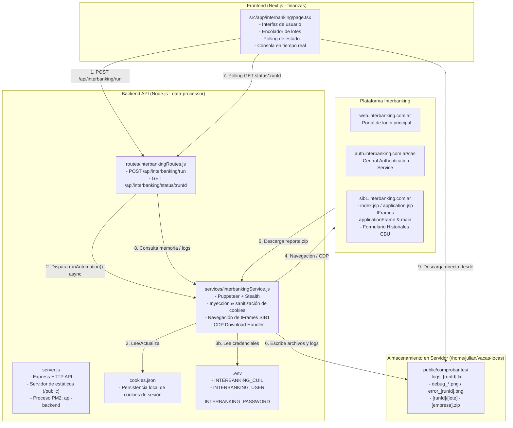
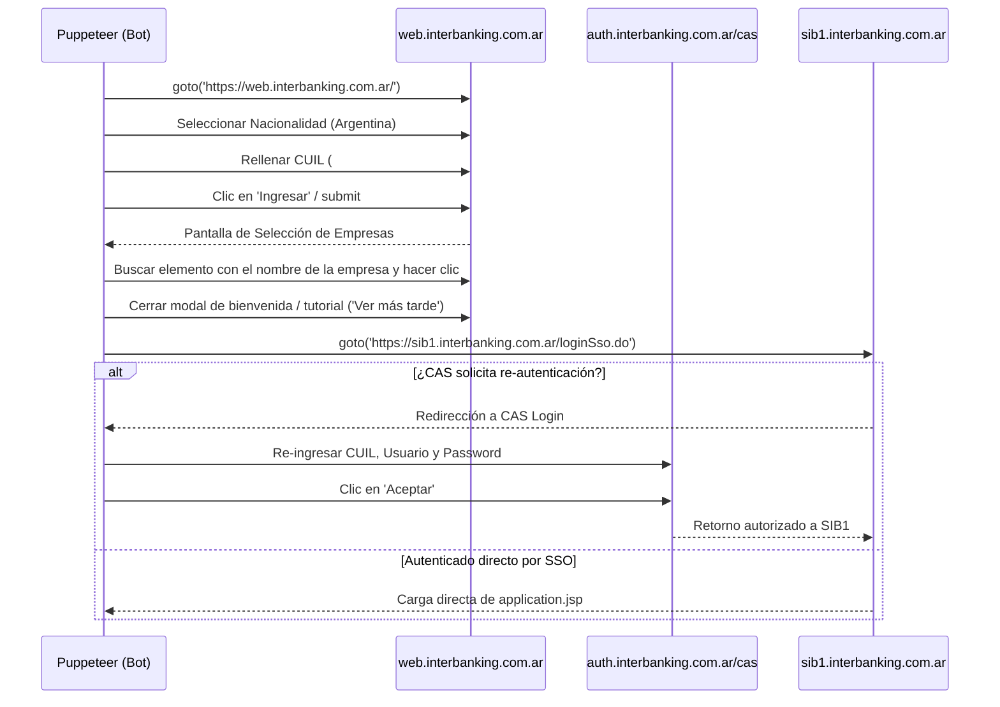
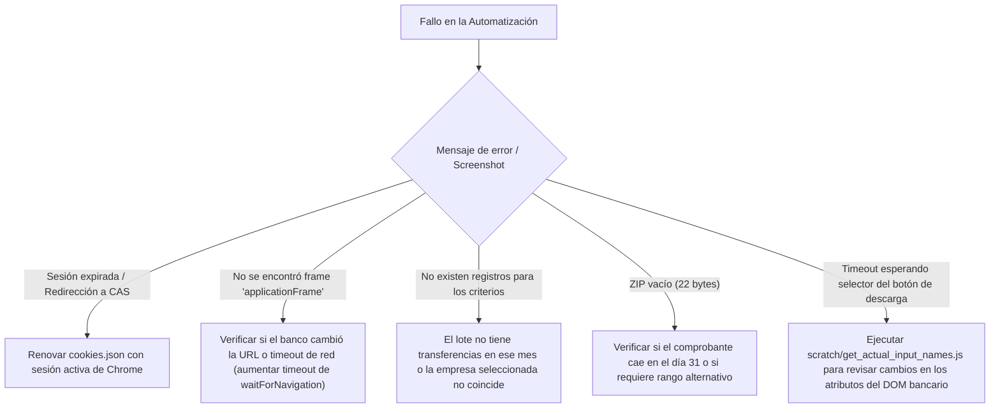

# INSTRUCTIVO TÉCNICO COMPLETO: AUTOMATIZACIÓN DE INTERBANKING

> **Destinatario:** Documento técnico de referencia para desarrolladores e Inteligencias Artificiales encargadas del mantenimiento, debugging o ampliación del módulo de descarga automatizada de comprobantes de Interbanking.
> **Versión:** 2.0 (Actualizada a Octubre 2026)
> **Servidor Backend:** `https://apivacas.jariel.com.ar` (Host local: `/home/julian/vacas-locas/data-processor`)
> **Frontend:** Módulo Next.js en `/home/julian/vacas-locas/finanzas/src/app/interbanking`

---

## 1. RESUMEN EJECUTIVO Y OBJETIVO DEL SISTEMA

El módulo de Interbanking permite a los administradores de finanzas descargar comprobantes de transferencias bancarias de forma desatendida y por lotes (números de lote) para distintas empresas del grupo (**CINEMARK ARGENTINA S.A.**, **HOYTS GENERAL CINEMA DE ARGENTINA SA**, **CINEMARK ARGENTINA SRL**, **BULNES**, etc.).

Debido a que el portal bancario de Interbanking carece de una API pública abierta para descarga directa de comprobantes en PDF y opera sobre una plataforma heredada basada en **IFrames, SSO de CAS y formularios JSP clásicos**, la solución implementa un **robot de navegación invisible basado en Puppeteer con técnicas de evasión de detección (Stealth)** alojado en el servidor backend.

El sistema soporta:
1. **Inicio de sesión instantáneo por inyección de cookies de sesión**.
2. **Fallback automático a login tradicional por formulario (CUIL, Usuario, Password) con navegación SSO**.
3. **Mapeo inteligente de campos de fecha y lote con soporte para selects dinámicos**.
4. **Manejo estricto de la regla bancaria de 30 días de rango** (incluyendo doble consulta en meses de 31 días).
5. **Captura y descarga de archivos ZIP/PDF mediante Chrome DevTools Protocol (CDP)**.
6. **Renombrado semántico de comprobantes** y transmisión directa al navegador del usuario.
7. **Encolamiento secuencial de lotes** desde el frontend.

---

## 2. ARQUITECTURA GENERAL Y TOPOLOGÍA DE ARCHIVOS

### 2.1 Diagrama de Arquitectura de Extremo a Extremo



### 2.2 Inventario de Archivos y Responsabilidades

| Ubicación del Archivo | Rol / Responsabilidad |
| :--- | :--- |
| **`/home/julian/vacas-locas/finanzas/src/app/interbanking/page.tsx`** | Componente de cliente Next.js. Maneja el formulario de parámetros (empresa, mes, lotes), encolador FIFO de lotes, polling a la API cada 1.5s, visualizador de logs y disparador de descargas automáticas en el navegador. |
| **`/home/julian/vacas-locas/data-processor/server.js`** | Servidor Express principal. Expone `/api/interbanking` mediante `interbankingRoutes.js` y sirve archivos estáticos (`app.use(express.static(path.join(__dirname, '../public')))`). Corre bajo PM2 (`api-backend`). |
| **`/home/julian/vacas-locas/data-processor/routes/interbankingRoutes.js`** | Router de Express. Endpoint `POST /run` (inicia el trabajo en segundo plano, genera un `runId` único) y `GET /status/:runId` (reporta progreso, logs y enlaces a los archivos descargados). |
| **`/home/julian/vacas-locas/data-processor/services/interbankingService.js`** | **Núcleo de la automatización (1,162 líneas)**. Inicia Puppeteer con Stealth, aplica cookies o ejecuta login tradicional, recorre IFrames, completa filtros bancarios, maneja descarga con CDP, renombra el archivo y genera diagnósticos en caso de error. |
| **`/home/julian/vacas-locas/data-processor/cookies.json`** | Almacén JSON persistente en disco con las cookies de la sesión activa de Interbanking. Permite que múltiples ejecuciones reutilicen la misma sesión sin pedir cookies cada vez. |
| **`/home/julian/vacas-locas/data-processor/scratch/get_actual_input_names.js`** | Script de diagnóstico y desarrollo. Permite ejecutar una inspección aislada del DOM de SIB1 para validar nombres de inputs y estructuras de frames sin pasar por la API web. |
| **`/home/julian/vacas-locas/data-processor/.env`** | Variables de entorno con credenciales de fallback: `INTERBANKING_CUIL`, `INTERBANKING_USER`, `INTERBANKING_PASSWORD`. |
| **`/home/julian/vacas-locas/public/comprobantes/`** | Directorio público donde se almacenan las carpetas de cada corrida (`runId`), los archivos renombrados (`[lote] - [empresa].zip`), los logs de auditoría (`logs_[runId].txt`) y las capturas de error (`error_[runId].png`). |
| **Proceso PM2 `api-backend`** | Proceso Daemon en el servidor. ID: `0`. Comandos: `pm2 status`, `pm2 logs api-backend`, `pm2 restart api-backend`. |

---

## 3. MECANISMO DE COOKIES AL DETALLE

### 3.1 ¿Por qué se utilizan cookies?
El portal de Interbanking cuenta con medidas de seguridad complejas:
- Autenticación multifactor o validación de dispositivo eventual.
- Redirecciones entre `web.interbanking.com.ar`, `auth.interbanking.com.ar/cas` y `sib1.interbanking.com.ar`.
- Pantallas intermedias de bienvenida, tutoriales y selección de empresa.

Cuando un operador inicia sesión manualmente en su navegador de oficina (Chrome), las cookies de sesión resultantes otorgan acceso directo al subsistema transaccional **SIB1**. Al inyectar estas cookies en Puppeteer, **el bot omite el 100% de las pantallas de login, SSO y selección de empresa**, ingresando directamente a `https://sib1.interbanking.com.ar/index.jsp` en menos de 5 segundos.

### 3.2 Formato y Sanitización de Cookies
Las cookies suelen ser exportadas desde Chrome con extensiones populares como **EditThisCookie** o **Cookie-Editor** en formato JSON.

Sin embargo, el formato exportado por extensiones de Chrome difiere de las especificaciones de Puppeteer / Chrome DevTools Protocol:
1. Chrome exporta la propiedad `expirationDate` en punto flotante. Puppeteer requiere la propiedad `expires` en formato numérico entero.
2. Extensiones como EditThisCookie inyectan metadatos propietarios como `id` y `storeId`. Si estos campos se pasan a `page.setCookie()`, Puppeteer lanzará una excepción.

#### Algoritmo de Sanitización implementado en `interbankingService.js`:
```javascript
const sanitizedCookies = cookiesToUse.map(c => {
    const sanitized = { ...c };
    // Normalizar tiempo de expiración
    if (sanitized.expirationDate !== undefined) {
        sanitized.expires = Number(sanitized.expirationDate);
        delete sanitized.expirationDate;
    }
    if (sanitized.expires !== undefined) {
        sanitized.expires = Number(sanitized.expires);
    }
    // Eliminar atributos propietarios incompatibles
    delete sanitized.id;
    delete sanitized.storeId;
    return sanitized;
});

await page.setCookie(...sanitizedCookies);
```

### 3.3 Ciclo de Vida y Persistencia de Cookies
1. **Recepción desde el Frontend:** Si el usuario ingresa un JSON en el campo "JSON de Cookies (Opcional)" del formulario, este viaja en `req.body.cookies`.
2. **Escritura en disco:** El servicio guarda automáticamente este JSON en `/home/julian/vacas-locas/data-processor/cookies.json`.
3. **Reutilización:** En las ejecuciones siguientes, si el usuario no envía cookies nuevas, el backend lee automáticamente `cookies.json`.
4. **Validación de Expiración:**
   - Si la sesión caducó, Interbanking suele abrir un `window.alert()` ("Su sesión ha expirado") o redirige a `https://auth.interbanking.com.ar/cas/login`.
   - El bot escucha diálogos con `page.on('dialog')`. Si detecta `"expir"`, `"sesion"` o `"invalida"`, marca `sessionExpired = true` y conmuta de inmediato al **Flujo de Fallback (Login tradicional)**.

---

## 4. FLUJO DE FALLBACK: LOGIN TRADICIONAL Y SSO

Si las cookies no están disponibles o han expirado, el robot ejecuta la secuencia de autenticación tradicional:



---

## 5. ESTRUCTURA INTERNA DE SIB1 Y MANEJO DE IFRAMES

El portal bancario transaccional `SIB1` está desarrollado con tecnología Java EE / JSP antigua y depende críticamente de una jerarquía de Framesets.

### 5.1 Jerarquía de Frames
```text
Ventana Principal (https://sib1.interbanking.com.ar/index.jsp)
│
└── applicationFrame (https://sib1.interbanking.com.ar/application.jsp)
    │
    ├── topFrame (Cabecera y logo del banco)
    ├── menuFrame (Menú lateral de opciones)
    └── main (Subframe donde se renderizan las pantallas operativas)
        URL: https://sib1.interbanking.com.ar/menuSelection.do?...
```

### 5.2 Estrategia de Localización del Formulario
El bot no asume nombres rígidos de frames que puedan cambiar con actualizaciones del banco. En su lugar, itera dinámicamente sobre `page.frames()` buscando aquel que contenga los inputs característicos de la búsqueda:

```javascript
formFrame = null;
for (const frame of page.frames()) {
    const hasFields = await frame.evaluate(() => {
        const inputs = Array.from(document.querySelectorAll('input'));
        return inputs.some(i => {
            const name = (i.name || i.id || i.placeholder || '').toLowerCase();
            return name.includes('desde') || name.includes('lote') || name.includes('hasta');
        });
    });
    if (hasFields) {
        formFrame = frame;
        break;
    }
}
```

### 5.3 Mapeo y Llenado de Inputs del Formulario de Búsqueda
En el frame operativo (`main`), el formulario posee los siguientes campos técnicos:

| Campo Visible en Pantalla | Atributo `name` en el HTML | Tipo de Elemento | Valor Asignado |
| :--- | :--- | :--- | :--- |
| **Fecha Solicitud Desde** | `filtro.fechaSolicitudDesde` | `<select>` o `<input>` | Fecha calculada de inicio (`DD/MM/YYYY`) |
| **Fecha Solicitud Hasta** | `filtro.fechaSolicitudHasta` | `<select>` o `<input>` | Fecha calculada de fin (`DD/MM/YYYY`) |
| **Nro. de Lote** | `filtro.nroLote_numeric` | `<input type="text">` | Número de lote provisto (ej: `195`) |
| **Nro. de Lote (Oculto)** | `filtro.nroLote` | `<input type="hidden">` | Se sincroniza en paralelo con el visible |
| **Formato de Bajada** | `filtro.formatoBajada` | `<select>` | `COMP_POR_PDF` ("Un comprobante por PDF") |

> [!IMPORTANT]
> **Inyección dinámica de opciones en `<select>` de fechas:**
> En SIB1, los campos de fecha suelen presentarse como listas desplegables (`<select>`). Si la fecha solicitada no se encuentra entre las opciones precargadas del banco, el bot **crea dinámicamente un nodo `<option>` con JavaScript en el DOM del iframe** y despacha el evento `change`:
> ```javascript
> opt = document.createElement('option');
> opt.value = val;
> opt.text = val;
> select.appendChild(opt);
> select.value = opt.value;
> select.dispatchEvent(new Event('change', { bubbles: true }));
> ```

---

## 6. REGLAS DE NEGOCIO Y MANEJO DEL LÍMITE DE 30 DÍAS

Interbanking impone una restricción de validación rígida en su servidor: **el rango entre la Fecha Desde y la Fecha Hasta no puede superar los 30 días corridos (inclusive)**. Cualquier consulta con un rango mayor a 30 días es rechazada con un error de validación.

### Estrategia de Búsqueda en Meses de 31 Días:
Para consultar un mes completo de 31 días (como enero, marzo, mayo, julio, agosto, octubre o diciembre) sin superar el límite de 30 días, el sistema implementa una **lógica de reintento inteligente en 2 etapas**:

1. **Intento 1 (Días 01 al 30):**
   - Fecha Desde: `01/MM/YYYY`
   - Fecha Hasta: `30/MM/YYYY`
   - Dispara la descarga.
2. **Verificación de Resultado Vacío:**
   - Un archivo `reporte.zip` generado por Interbanking que **no contiene comprobantes tiene un tamaño exacto de 22 bytes** (cabecera vacía de PKZIP).
3. **Intento 2 (Días 02 al 31):**
   - Si el Intento 1 arrojó un ZIP de 22 bytes o no descargó archivos, el bot elimina el archivo vacío y relanza la búsqueda para el rango restante:
   - Fecha Desde: `02/MM/YYYY`
   - Fecha Hasta: `31/MM/YYYY`

### Mes en Curso:
Si el mes seleccionado coincide con el mes calendario actual, la Fecha Hasta se limita automáticamente a la fecha del día de hoy para evitar consultas sobre fechas futuras.

---

## 7. INTERCEPCIÓN DE DESCARGAS Y PROCESAMIENTO DE ARCHIVOS

### 7.1 Configuración de Descarga mediante CDP
Puppeteer en modo headless bloquea por defecto las descargas directas del navegador. Para solventar esto, se utiliza una sesión de **Chrome DevTools Protocol (CDP)** vinculada a la página:

```javascript
const client = await page.target().createCDPSession();
await client.send('Page.setDownloadBehavior', {
    behavior: 'allow',
    downloadPath: path.resolve(runDownloadDir),
});
```

### 7.2 Disparo del Botón de Descarga
El botón de descarga en SIB1 es una imagen con nombre dinámico:
- Selector principal: `img[name^="img_boton_descargarComprobantes"]`
- Selectores alternativos: `img[alt*="Descargar Comprobante" i]`, `img[src*="descargar_comprobantes" i]`
- Se realiza scroll al elemento (`scrollIntoView`), evento `hover` y clic físico de Puppeteer, con fallback a `evaluate(el => el.click())`.

### 7.3 Gestión del Checklist de Columnas (si aparece)
En ciertas empresas y configuraciones de SIB1, al presionar descargar se abre una pantalla intermedia con un checklist de columnas a exportar:
1. El bot detecta si existen más de 3 checkboxes (`checkboxes.length > 3`).
2. Localiza el checkbox "Seleccionar todos" (`all`, `todos`, `todas`) o marca todos los checkboxes iterativamente.
3. Localiza el botón de confirmación (`Aceptar`, `Continuar`, `Exportar`, `Descargar`, `OK`) y lo presiona.

### 7.4 Renombrado y Publicación de Archivos
1. El archivo descargado inicialmente se llama habitualmente `reporte.zip` en `/home/julian/vacas-locas/public/comprobantes/${runId}/`.
2. El bot lo renombra a un formato limpio y descriptivo:
   ```text
   [lote] - [empresa].[ext]
   Ejemplo: 195 - HOYTS GENERAL CINEMA DE ARGENTINA SA.zip
   ```
3. Se genera la URL de acceso público:
   `https://apivacas.jariel.com.ar/comprobantes/${runId}/195%20-%20HOYTS%20GENERAL%20CINEMA%20DE%20ARGENTINA%20SA.zip`
4. Esta URL es devuelta al frontend en el payload de estado.

---

## 8. ESPECIFICACIÓN DE LA API BACKEND

### Endpoint 1: Iniciar Automatización
- **URL:** `POST https://apivacas.jariel.com.ar/api/interbanking/run`
- **Headers:** `Content-Type: application/json`
- **Body Payload:**
  ```json
  {
    "company": "HOYTS GENERAL CINEMA DE ARGENTINA SA",
    "lote": "195",
    "monthYear": "2026-06",
    "customCredentials": {
      "cuil": "20XXXXXXXXX",
      "user": "gpainemal",
      "pass": "MiPassword123"
    },
    "cookies": [
      {
        "name": "sib",
        "value": "...",
        "domain": ".interbanking.com.ar",
        "path": "/",
        "expirationDate": 1788983170
      }
    ]
  }
  ```
  *(Nota: `customCredentials` y `cookies` son opcionales).*
- **Respuesta Exitosa (200 OK):**
  ```json
  {
    "success": true,
    "runId": "195_1788896933129",
    "message": "El proceso de automatización ha sido iniciado en el servidor en segundo plano."
  }
  ```

### Endpoint 2: Consultar Estado de la Ejecución
- **URL:** `GET https://apivacas.jariel.com.ar/api/interbanking/status/:runId`
- **Respuesta en Progreso (200 OK):**
  ```json
  {
    "success": true,
    "status": "running",
    "logs": [
      "[16:48:53] Iniciando automatización para lote 195...",
      "[16:48:58] ✅ Sesión establecida correctamente..."
    ],
    "files": [],
    "screenshotUrl": null,
    "error": null,
    "updatedAt": "2026-10-15T19:48:58.000Z"
  }
  ```
- **Respuesta Completada con Éxito (200 OK):**
  ```json
  {
    "success": true,
    "status": "completed",
    "logs": [ ... ],
    "files": [
      {
        "name": "195 - HOYTS GENERAL CINEMA DE ARGENTINA SA.zip",
        "url": "https://apivacas.jariel.com.ar/comprobantes/195_1788896933129/195%20-%20HOYTS%20GENERAL%20CINEMA%20DE%20ARGENTINA%20SA.zip",
        "localPath": "/home/julian/vacas-locas/public/comprobantes/195_1788896933129/195 - HOYTS GENERAL CINEMA DE ARGENTINA SA.zip"
      }
    ],
    "screenshotUrl": null,
    "error": null,
    "updatedAt": "2026-10-15T19:49:07.000Z"
  }
  ```
- **Respuesta de Fallo (200 OK con status 'failed'):**
  ```json
  {
    "success": true,
    "status": "failed",
    "logs": [ ... ],
    "files": [],
    "screenshotUrl": "https://apivacas.jariel.com.ar/comprobantes/error_195_1788896933129.png",
    "error": "El banco reporto: 'No existen registros para los criterios ingresados.'",
    "updatedAt": "2026-10-15T19:49:10.000Z"
  }
  ```

---

## 9. EL FRONTEND EN FINANZAS (NEXT.JS)

El archivo `src/app/interbanking/page.tsx` administra el ciclo de vida del cliente:
1. **Control de Acceso:** Restringido al usuario `julian` mediante `useAuth()`.
2. **Encolador de Lotes:** El usuario puede ingresar múltiples lotes separados por coma o espacio (ej: `152, 153, 154`). El estado `queue` toma los números y ejecuta una solicitud a la vez, esperando 5 segundos entre lote y lote para no saturar al banco ni al servidor.
3. **Consola en Vivo:** Mediante polling cada 1500ms al endpoint de estado, renderiza los logs del servidor con scroll automático (`scrollIntoView`).
4. **Descarga Transparente:** Tan pronto como `status === "completed"`, el frontend crea un elemento `<a download>` y dispara el clic programático para que el archivo se guarde directamente en la carpeta de descargas del navegador del usuario.
5. **Diagnóstico con Imagen:** Si la ejecución falla, el frontend muestra la captura de pantalla (`screenshotUrl`) capturada por Puppeteer en el instante del error.

---

## 10. GUÍA PASO A PASO PARA OTRA IA O DESARROLLADOR

Si necesitas modificar, solucionar problemas o extender este sistema, sigue estas instrucciones estándar:

### 10.1 Cómo actualizar las Cookies de Sesión
Cuando las cookies expiren (ocurre cada varios días o al cerrar sesión en el navegador):
1. Inicia sesión normalmente en `https://web.interbanking.com.ar` desde Google Chrome.
2. Abre la extensión **EditThisCookie** y haz clic en el botón de exportar (copia un JSON al portapapeles).
3. **Método A (Desde la Web de Finanzas):**
   - Entra en `/interbanking`.
   - Abre "Modificar Credenciales de Acceso (Opcional)".
   - Pega el JSON en "JSON de Cookies (Opcional)" y presiona "Iniciar Descargas".
   - El backend guardará automáticamente el nuevo contenido en `cookies.json`.
4. **Método B (Directo en el Servidor):**
   - Guarda el JSON directamente en `/home/julian/vacas-locas/data-processor/cookies.json`.

### 10.2 Comandos Útiles del Servidor
```bash
# Ver estado del proceso backend
pm2 status api-backend

# Ver logs en tiempo real del backend
pm2 logs api-backend --lines 100

# Reiniciar el servicio tras modificar servicios o rutas
pm2 restart api-backend

# Inspeccionar logs históricos de una ejecución específica
cat /home/julian/vacas-locas/public/comprobantes/logs_[runId].txt

# Probar inspección de DOM de SIB1 en forma aislada
cd /home/julian/vacas-locas/data-processor
node scratch/get_actual_input_names.js
```

### 10.3 Árbol de Decisión para Debugging



---

## 11. CONCLUSIÓN

La arquitectura está diseñada para ser resiliente a fallas transitorias, aislar el consumo de memoria mediante Puppeteer headless efímero (cerrando el navegador al finalizar cada lote) y desacoplar completamente la interfaz de usuario de las complejidades del protocolo bancario heredado.
Cualquier modificación futura debe respetar el límite de 30 días de rango de fechas y la jerarquía de subframes de SIB1.
